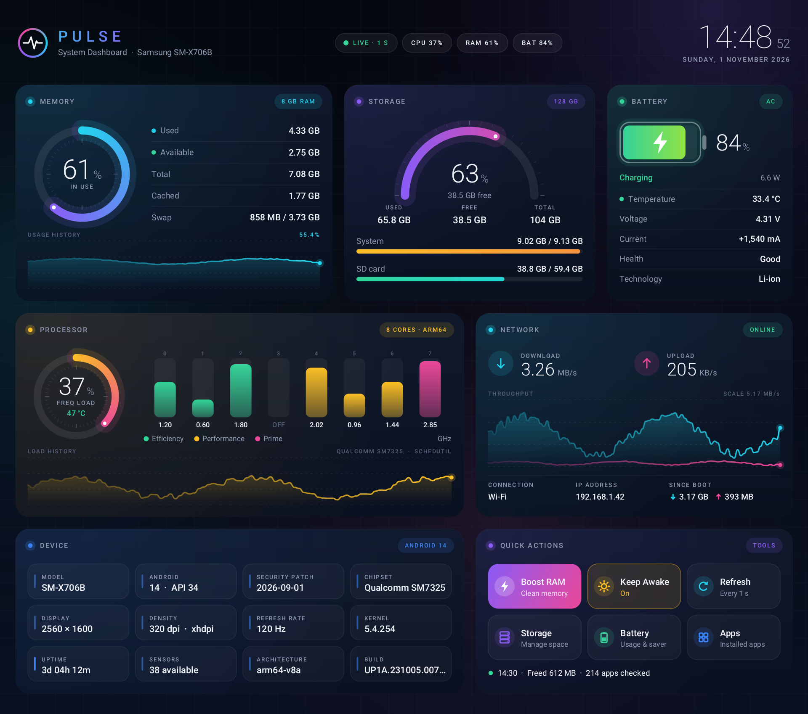
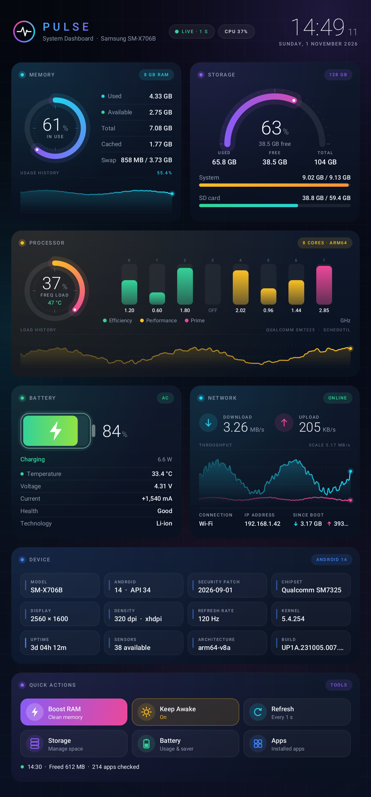

# Pulse — System Dashboard for Android Tablets

A real-time dashboard for RAM, storage, CPU, battery and network use. It runs fullscreen and is built for Android tablets. Every gauge, chart and icon is drawn as vectors on the canvas, so it stays sharp at any screen resolution.



## Download

**[release/PulseDashboard.apk](release/PulseDashboard.apk)** — signed APK, about 107 KB. Needs Android 6.0 or newer (min SDK 23, target SDK 34).

To install it, turn on *Install unknown apps* for your file manager or browser and open the APK. Play Protect may warn you because the app isn't from the Play Store; tap *Install anyway*.

## Features

| Card | What it shows |
|---|---|
| **Memory** | Ring gauge of RAM in use; used, available, total, cached and swap/zRAM; usage history graph |
| **Storage** | Half-circle gauge for internal storage; used, free and total; system partition and SD card bars |
| **Processor** | Live speed bar for each core, coloured by cluster (efficiency / performance / prime); overall load; CPU temperature where readable; load history |
| **Battery** | Battery icon with fill level, %, charging state, watts, temperature (colour-coded), voltage, current, health, chemistry |
| **Network** | Live download and upload speeds, throughput graph, connection type, IP address, data used since boot |
| **Device** | Model, Android version and API level, security patch, chipset, resolution, density, refresh rate, kernel, uptime, sensors, build |
| **Quick actions** | Boost RAM (closes background apps and reports the memory freed), Keep Awake, sampling rate (0.5 / 1 / 2 s), shortcuts to Storage, Battery and Apps settings |

The layout adapts to the screen: three columns on a landscape tablet, two in portrait, one on a phone.



### Notes
- Android 8 and newer don't let apps read `/proc/stat`. On those devices the CPU card estimates load from core frequencies and labels it **FREQ LOAD**.
- CPU temperature appears only if the device lets apps read its thermal sensors.
- Boost RAM can only close cached background processes. That's an Android limit, and the app reports the memory it actually freed.

## Project layout

```
app/
  AndroidManifest.xml
  res/                     theme, strings, launcher icons
  src/com/abhijit/pulse/
    MainActivity.java      activity, sampling loop, actions, background
    Sys.java               live sampling (memory, storage, CPU, thermal, battery, network)
    DashGrid.java          responsive 12-column grid
    Card.java              base glass card
    RamCard / StorageCard / CpuCard / BatteryCard / NetworkCard / DeviceCard / ActionsCard
    HeaderView.java        brand, live chips, clock
    Gfx.java, Chart.java   vector drawing primitives
    Ui.java, History.java  palette, type, formatting, ring buffer
tools/
  build.sh                 builds and signs the APK
  icon.py                  generates the launcher icons
release/PulseDashboard.apk
```

Plain Java with no AndroidX, Kotlin or Gradle, and no third-party libraries.

## Building

On Ubuntu/Debian:

```bash
sudo apt install openjdk-17-jdk aapt apksigner zipalign dalvik-exchange android-sdk-platform-23
tools/build.sh            # output: build/PulseDashboard.apk
```

Set `KEYSTORE=/path/to/your.keystore` to sign with your own key. If you don't, a key is created at `~/.pulse.keystore`. To install an update over the app already on your tablet, sign it with the same key.
